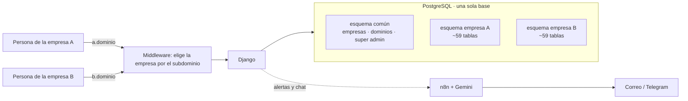

# Arquitectura multiempresa

AuditHub es una sola aplicación que atiende a **muchas empresas**. Los datos de cada una están separados.

## Decisiones

- **Un esquema de PostgreSQL por empresa** (django-tenants). Una consulta nunca puede mezclar datos de dos empresas porque las tablas son distintas.
- **La empresa se elige por subdominio.** El mismo código sirve a todas.
- **Esquema común**: empresas, dominios y super administradores. **Esquema de empresa**: usuarios, auditorías, hallazgos, planes, notificaciones, configuración, ayuda, biblioteca de riesgos.
- **Límite de usuarios por empresa** (0 a 100 000; 0 = ilimitado), aplicado en la base con un bloqueo para que dos altas simultáneas no lo superen.
- **Alta de empresa automatizada:** crea el esquema, sus tablas y el primer administrador con contraseña temporal y cambio obligatorio al entrar.
- **Migraciones** (87): se aplican a cada empresa, así que una actualización llega a todas.
- **Acceso por sesión** de Django (cookies, protección CSRF); no se usa JWT porque la aplicación se renderiza en el servidor.
- **IA fuera del núcleo:** el modelo se llama desde n8n, no desde Django, de modo que se puede cambiar de proveedor sin tocar la aplicación.
